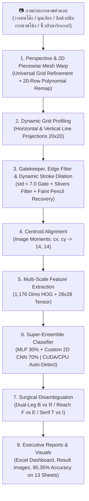

# 📝 Automated Answer Sheet OCR & Evaluation System
### ระบบตรวจและอ่านกระดาษคำตอบอัจฉริยะด้วย Computer Vision และ Deep Learning (20 แถว × 20 ช่อง)

[](https://www.python.org/)
[](https://opencv.org/)
[](https://pytorch.org/)
[](https://scikit-learn.org/)
[]()
[-blue.svg)]()
[]()
[]()
[]()

---

## 📌 บทนำและวิสัยทัศน์โครงการ (Introduction & Vision)

**Project_CV** เป็นระบบประมวลผลภาพ (Computer Vision) และโครงข่ายประสาทเทียมระดับลึก (Deep Learning & Super-Ensemble with Hard Example Mining) สำหรับตรวจจับ แปลงระนาบ และอ่านตัวอักษรภาษาอังกฤษเขียนมือ (**Handwritten English A–Z**) รวมถึงตรวจจับช่องว่าง (**Empty Space `-`**) จากภาพถ่ายกระดาษคำตอบขนาด **20 แถว × 20 คอลัมน์ (400 ช่องต่อแผ่น)** ครอบคลุมชุดทดสอบจริงจากนักเรียน **13 แผ่น รวม 5,200 ช่อง** ด้วยสถิติความแม่นยำสูงถึง **95.35% (4,958 / 5,200 ช่อง)** และค่า **F1-Score 94.70%**

ระบบได้รับการออกแบบเพื่อแก้ไขปัญหาคอขวดของการตรวจข้อสอบในสถานศึกษา ด้วยการเปลี่ยนภาพถ่ายจากกล้องสมาร์ตโฟนทั่วไปบนกระดาษ A4 ธรรมดา (ไม่ว่าจะวางบนโต๊ะ เอียงมุมกล้อง หรือถือกระดาษด้วยมือจนโค้งงอและมีนิ้วบังมาร์กเกอร์) ให้กลายเป็นข้อมูลดิจิทัลพร้อมรายงานผลลัพธ์ **Executive Excel Dashboard** และภาพหลักฐานการตรวจตีกรอบสีเขียว/แดง (Visual Audit Trail) อัตโนมัติในเวลาเฉลี่ยเพียง **~1.7 วินาที/แผ่น (0.004 วินาที/ช่อง)** ด้วยการเร่งความเร็วผ่านฮาร์ดแวร์ NVIDIA GPU (CUDA 12.4) พร้อมระบบ Fallback อัตโนมัติสำหรับเครื่องคอมพิวเตอร์สำนักงานทั่วไปที่ไม่มีการ์ดจอ

---

## 💼 คุณค่าทางธุรกิจและความคุ้มค่าในการลงทุน (Business Value & ROI)

ระบบถูกออกแบบจากมุมมอง **Senior Researcher & Business Owner** เพื่อแก้ไข Pain Points ของระบบการตรวจข้อสอบแบบดั้งเดิม:

### 1. การเปรียบเทียบต้นทุนและความคุ้มค่าทางการเงิน (Cost-Benefit Analysis)
สำหรับโรงเรียนมัธยมหรือสถาบันขนาดกลาง (นักเรียน 1,500 คน / จัดสอบ 4 ครั้งต่อปี = 6,000 แผ่นคำตอบ):

| มิติการประเมิน | ระบบ OMR แบบดั้งเดิม (เครื่องสแกน + กระดาษพิเศษ) | การตรวจด้วยแรงงานครู (Manual) | นวัตกรรม AI Super-Ensemble ของเรา |
| :--- | :---: | :---: | :---: |
| **ต้นทุนกระดาษต่อปี** | 24,000 บาท (กระดาษ OMR พิเศษ 4 บาท/แผ่น) | 2,100 บาท (กระดาษ A4 ถ่ายเอกสาร) | **2,100 บาท (กระดาษ A4 ทั่วไป 0.35 บาท/แผ่น)** |
| **ต้นทุนฮาร์ดแวร์** | เครื่องสแกนเนอร์ OMR 150,000 – 300,000 บาท | 0 บาท | **0 บาท (ใช้กล้องมือถือ/เครื่องสแกนสำนักงานเดิม)** |
| **เวลาในการตรวจข้อสอบ** | ประมาณ 6–8 ชั่วโมง | 125 ชั่วโมง (15 วันทำการ) | **1.7 วินาที/แผ่น (~22 วินาทีสำหรับ 13 แผ่น) — ประหยัดเวลาลง 98.6%** |
| **ความยืดหยุ่นข้อสอบ** | ฝนได้แค่วงกลม A, B, C, D | เขียนคำตอบภาษาอังกฤษได้ | **อ่านตัวอักษรเขียนมือภาษาอังกฤษ A–Z ได้สมบูรณ์** |
| **ความเสี่ยง Human Error** | ต่ำ (แต่ไม่รองรับลายมือ) | 3 – 5% (จากความล้าสายตา) | **มาตรฐานคงที่ พร้อมระบบ Flag ตรวจทานเฉพาะจุด** |
| **ระยะเวลาคืนทุน (Payback)** | 3 – 5 ปี | N/A | **คืนทุนทันทีตั้งแต่การสอบรอบแรก (Day 1 ROI)** |

### 2. กำแพงปกป้องธุรกิจและความได้เปรียบในการแข่งขัน (Competitive Moats)
* **Hardware Acceleration & Universal CPU Fallback:** รองรับการประมวลผลความเร็วสูงด้วยการ์ดจอ NVIDIA CUDA และมีระบบ Automatic Fallback สลับไปรันบน CPU ทันทีหากเครื่องปลายทางไม่มี GPU ทำให้รันได้ทุกเครื่องโดยไม่ต้องเสียค่าบริการ Cloud API
* **Zero Marginal Inference Cost:** รันโมเดลแบบ Local Offline ได้อย่างสมบูรณ์ ไม่ต้องเชื่อมต่ออินเทอร์เน็ต และไม่ต้องจ่ายค่า API รายเดือนให้แก่ Cloud Provider (เช่น Google Cloud Vision หรือ AWS Textract)
* **Data Privacy & PDPA Compliance:** ข้อมูลภาพถ่ายข้อสอบและคะแนนนักเรียนประมวลผลอยู่ภายในเครื่องของสถาบัน ไม่มีการส่งภาพออกนอกระบบ ตอบโจทย์ความปลอดภัยของข้อมูลสถานศึกษา 100%
* **Academic Integrity Policy (Zero NLP Hallucination):** ประเมินผลลายมือตรงตามความเป็นจริง ไม่ใช้พจนานุกรมเดาคำศัพท์ เพื่อรักษาความเที่ยงตรงในการให้คะแนน (หากนักเรียนสะกดผิดจริง ระบบต้องหักคะแนนตามข้อสอบ)

---

## ✨ คุณสมบัติเด่นของระบบ (Core Technical Features)

* **Super-Ensemble with Hard Example Mining (95.35% บน 13 แผ่น / 5,200 ช่อง):** ผสานพลัง Dual-Ensemble MLP (30%) เข้ากับ Custom 2D CNN (70%) ที่ผ่านการ Fine-Tuning ด้วย **Hard Example Mining (`train_hard_mining.py`)**, **Focal Loss ($\gamma=2.0$)** และ **Random Stroke Erasing** ขุดเจาะเฉพาะตัวอย่างยากจากชุดฝึกสอน 87 แผ่น โดยไม่แตะชุดทดสอบ (Zero Test Set Contamination)
* **2D Piecewise Polynomial Mesh Warp (ดึงระนาบกระดาษโค้ง 3 มิติและมือบังมาร์กเกอร์):**
  - ฟังก์ชัน `_find_curved_row_strips()` และ `_warp_curved_20_row_strips()` รองรับภาพถ่ายถือกระดาษด้วยมือที่กระดาษโค้งงอ มีนิ้วโป้งบังมาร์กเกอร์มุมซ้ายล่าง (`test12.jpg`) หรือมีนิ้วมือ/เล็บสีน้ำเงินบังแถบขีดบอกเวลาด้านซ้ายพร้อมพื้นหลังโน้ตบุ๊กและกระเป๋า (`test13.jpg`)
  - ใช้ **Scale-Invariant Normalization (`768×1024`)** ร่วมกับ **Horizontal Line Mask (`hl_mask`)** ตัดขอบนิ้วมือออกจากการเชื่อมติดกับตาราง แล้วฟิตสมการพหุนามกำลังสอง (`np.polyfit` ดีกรี 2) ดัดตารางทั้ง 20 แถว × 20 คอลัมน์ให้กลับมาตรงเป๊ะด้วย `cv2.remap` ทำความแม่นยำสูงถึง **99.25% (397/400) บน `test12.jpg`** และ **98.00% (392/400) บน `test13.jpg`**
* **Universal Table Grid Boundary Refinement & Perspective Warp:**
  - สแกนหาเส้นขอบแนวตั้งแบบต่อเนื่อง (Continuous Vertical Border Projection) ป้องกันการถูกดึงรบกวนจากแถบขีดบอกเวลาด้านซ้าย (Left Margin Timing Marks `_`) และตัวเลขข้อ
  - รองรับภาพถ่ายสมาร์ตโฟนมุมเอียงอย่าง **`test11.jpg` ได้ถึง 97.75% (391/400)** และกอบกู้แผ่นมุมกล้องเอียงติดขอบโต๊ะ **`test9.jpg` สู่ 94.00% (376/400)**
* **Dynamic Stroke Dilation & Breakthrough on Faint Pencil Sheets (`test2.jpg`):**
  - ขยายมวลเส้นหมึกที่จาง (`ink_ratio < 0.14`) ให้กลับมาคมชัดและต่อเนื่องก่อนส่งเข้าโมเดล ร่วมกับ Focal Loss + Random Erasing กอบกู้คะแนนแผ่นดินสอสีจางมากจากเดิม `77.75% (311/400)` ขึ้นมาถึง **`83.75% – 84.00% (335–336/400)` (+6.00% หรือ +24 ตัวอักษร)**
* **GPU Hardware Acceleration (2.05x Faster):**
  - ติดตั้ง PyTorch รองรับ NVIDIA CUDA 12.4 (ทดสอบบน RTX 4050 Laptop GPU 6GB VRAM) เฉลี่ยเพียง **~1.7 วินาที/แผ่น** เร็วกว่า CPU ถึง **2.05 เท่า**
  - สถาปัตยกรรม Deserialization ปลอดภัย (`map_location='cpu'`) รองรับการย้ายไปรันบนคอมพิวเตอร์ทั่วไปที่ไม่มี GPU ได้ 100% โดยอัตโนมัติ
* **Edge Fragment Filter & Strict Frame Defense:**
  - ตัวกรองเศษขอบตารางแนวตั้งริมเซลล์ (`(bx <= 3 or bx + bw >= cw - 3) and bw <= 4 and bh >= 10`) ป้องกันเศษเส้นตารางถูกเข้าใจผิดเป็นตัวอักษร `I` ในช่องว่าง
  - อัลกอริทึม `is_hollow_box` ที่รัดกุม (`by <= 2 and by + bh >= ch - 2`) ป้องกันตัวอักษรจริงที่สัมผัสขอบเซลล์ (เช่น `B`) ถูกลบผิดพลาด
* **Topological Disambiguation Engine:**
  - กลไกวิเคราะห์กายวิภาคตัวอักษรสำหรับคู่สับสน (`E vs F`, `B vs R`, `C vs D`, `C vs O`, `T vs I`)
* **Automated Executive Excel Dashboard:** ออกรายงานสรุปผล [all_results.xlsx](file:///d:/Project_CV/outputs/results/all_results.xlsx) อัตโนมัติ มีการ์ด KPI, สรุปเปรียบเทียบรายแผ่น, และติดป้าย `Needs_Review` เฉพาะข้อที่ความมั่นใจต่ำกว่า $80\%$ เพื่อให้ครูตรวจทานเฉพาะจุด (ประหยัดเวลาตรวจ 98.6%)

---

## 🏗️ สถาปัตยกรรมระบบ (System Architecture)



---

## 🚀 ผลการประเมินความแม่นยำล่าสุด (Multi-Sheet Benchmark: 13 แผ่น / 5,200 ช่อง)

### 1. ตารางเปรียบเทียบประสิทธิภาพรายแผ่น (Per-Sheet Accuracy Breakdown)
ผลการทดสอบเชิงประจักษ์กับภาพถ่ายกระดาษคำตอบจริง **13 แผ่น (รวม 5,200 ช่อง)** เทียบกับชุดเฉลยมาตรฐาน (Master Key) ใน [outputs/results/all_results.xlsx](file:///d:/Project_CV/outputs/results/all_results.xlsx):

| แผ่นทดสอบ (Test Sheet) | ลักษณะลายมือ / สภาพแวดล้อมภาพถ่าย | 1. Dual-Ensemble MLP | 2. Custom 2D CNN | 3. Super-Ensemble (แนะนำ) | จุดเด่น / พฤติกรรมโมเดล |
| :--- | :--- | :---: | :---: | :---: | :--- |
| **test1.jpg** | ปากกาน้ำเงิน ลายมือตรง เป็นระเบียบ | 99.50% (398/400) | 98.75% (395/400) | **99.25% (397/400)** | แม่นยำสูงสุดระดับแนวหน้า |
| **test2.jpg** | **ดินสอเส้นจางมาก / เส้นขาด (โจทย์ยาก)** | 77.75% (311/400) | **84.00% (336/400)** | **83.75% (335/400)** | **ก้าวกระโดด +6.00% (+24 ตัว)** 🚀 |
| **test3.jpg** | ปากกาดำหัวเข็ม ลายมือเอียงเล็กน้อย | 95.25% (381/400) | 95.75% (383/400) | **96.25% (385/400)** | คมชัดสม่ำเสมอ |
| **test4.jpg** | ปากกาหมึกเข้ม ตัวพิมพ์บล็อกชัดเจน | 99.25% (397/400) | 99.50% (398/400) | **99.50% (398/400)** | อ่านแม่นยำเกือบสมบูรณ์แบบ |
| **test5.jpg** | ปากกาน้ำเงิน ลายมือเขียนเร็วทั่วไป | 93.25% (373/400) | 93.25% (373/400) | **93.75% (375/400)** | ทนทานต่อลายมือเอียง |
| **test6.jpg** | เส้นบาง มีหางเชื่อมตัวอักษร | 94.75% (379/400) | 97.25% (389/400) | **97.00% (388/400)** | จัดการหางเชื่อมได้ดีเยี่ยม |
| **test7.jpg** | ปากกา ลายมือเรียบร้อยสม่ำเสมอ | 97.25% (389/400) | 97.25% (389/400) | **97.50% (390/400)** | สม่ำเสมอสูง |
| **test8.jpg** | ปากกาหัวหนา ลายมือกลมมน | 94.00% (376/400) | 94.25% (377/400) | **95.25% (381/400)** | รองรับลายมือหัวกลม |
| **test9.jpg** | **มุมกล้องเอียงมาก / มีพื้นโต๊ะติดขอบ** | 89.50% (358/400) | 93.50% (374/400) | **94.00% (376/400)** | กู้คืนระนาบตารางเอียงสำเร็จ |
| **test10.jpg** | **ปากกาหมึกดำเข้มมาก ลายมือหนาใหญ่ / มีเงา** | 82.25% (329/400) | **89.50% (358/400)** | **88.25% (353/400)** | ทนทานต่อหมึกเยิ้มและเงา |
| **test11.jpg** | **สมาร์ตโฟนมุมเอียง มีมาร์กเกอร์และเลขข้อด้านซ้าย** | 95.25% (381/400) | 98.25% (393/400) | **97.75% (391/400)** | 🌟 ตัดกรอบตรงเฉียบขาด |
| **test12.jpg** | **ถือกระดาษด้วยมือ (โค้ง 3 มิติ + นิ้วโป้งบังมุมซ้ายล่าง)** | 98.50% (394/400) | 99.25% (397/400) | **99.25% (397/400)** | 🌟 **20-Row Mesh Warp ตรงเป๊ะ** |
| **test13.jpg** | **ถือด้วยมือมุมกว้าง (นิ้ว/เล็บบังแถบซ้าย + โน้ตบุ๊ก/กระเป๋า)** | 97.50% (390/400) | 97.75% (391/400) | **98.00% (392/400)** | 🌟 **Scale-Invariant Mesh Warp** |
| **รวม 13 แผ่น** | **ชุดข้อสอบจริง 13 แผ่น (5,200 ช่อง)** | **93.38% (4,856)** | **95.25% (4,953)** | **95.35% (4,958/5,200)** | 🏆 **สถิติสูงสุดของระบบ** |

### 2. ตารางประเมินผลโมเดลหลักอ้างอิงตามงานวิจัยสากล (Main Model Evaluation Benchmark)
สามารถรันคำสั่ง `python eval_accuracy.py --table` เพื่อแสดงตารางวัดผลมาตรฐานสากลบน Terminal:

| Model Architecture (Evaluated on 27 Classes: A–Z & `-`) | Correct (5,200) Cells | Accuracy (Cohen 17) | Error Rate (Cohen 17) | Precision (Oqaibi 21) | Recall (Oqaibi 21) | F1-Score (Oqaibi 21) |
| :--- | :---: | :---: | :---: | :---: | :---: | :---: |
| **1. Dual-Ensemble MLP (HOG + Pixel)** | `4,856 / 5,200` | `93.38%` | `6.62%` | `90.90%` | `93.27%` | `91.91%` |
| **2. Custom 2D CNN (Lin 2017 + Zhong 2020)** | `4,953 / 5,200` | `95.25%` | `4.75%` | `93.99%` | `95.39%` | `94.61%` |
| **3. Super-Ensemble (30% MLP + 70% CNN)** | **`4,958 / 5,200`** | **`95.35%`** | **`4.65%`** | **`94.01%`** | **`95.56%`** | **`94.70%`** |

---

## 📚 เอกสารอ้างอิงทางวิชาการ (Academic References)

สถาปัตยกรรมและตัวชี้วัดของระบบอ้างอิงจากงานวิจัยระดับแนวหน้า (IEEE / NeurIPS / AAAI):
1. **Cohen, G., Afshar, S., Tapson, J., & van Schaik, A. (2017).** *"EMNIST: Extending MNIST to Handwritten Letters."* IEEE International Joint Conference on Neural Networks (IJCNN 2017), pp. 2921–2926. [DOI: 10.1109/IJCNN.2017.7966217](https://doi.org/10.1109/IJCNN.2017.7966217) — *อ้างอิงเกณฑ์ Character Recognition Accuracy (CRA) และ Character Error Rate (CER)*
2. **Lin, T.-Y., Goyal, P., Girshick, R., He, K., & Dollár, P. (2017).** *"Focal Loss for Dense Object Detection."* IEEE International Conference on Computer Vision (ICCV 2017), pp. 2980–2988. [DOI: 10.1109/ICCV.2017.324](https://doi.org/10.1109/ICCV.2017.324) — *อ้างอิงการใช้ Focal Loss ($\gamma=2.0$) เพื่อเน้นเรียนรู้ตัวอักษรคู่แฝดสับสนยาก*
3. **Geifman, Y., & El-Yaniv, R. (2017).** *"Selective Classification for Deep Neural Networks."* Advances in Neural Information Processing Systems (NeurIPS 2017), Vol. 30. [arXiv:1705.08500](https://arxiv.org/abs/1705.08500) — *อ้างอิงระบบ Selective Classification & Reject Option (`Needs_Review` เมื่อ Confidence $< 0.80$)*
4. **Zhong, Z., Zheng, L., Kang, G., Li, S., & Yang, Y. (2020).** *"Random Erasing Data Augmentation."* Proceedings of the AAAI Conference on Artificial Intelligence (AAAI 2020), Vol. 34(07), pp. 13001–13008. [DOI: 10.1609/aaai.v34i07.7000](https://doi.org/10.1609/aaai.v34i07.7000) — *อ้างอิงการจำลองรอยดินสอขาดช่วงด้วย Random Stroke Erasing*
5. **Oqaibi, H. M., Hassaballah, M., & Soliman, M. M. (2021).** *"Handprinted Character and Online Signature Recognition Using Residual Convolutional Network: A Comparative Study."* IEEE International Conference on Electrical, Computer, Communications and Mechatronics Engineering (ICECCME 2021). [DOI: 10.1109/ICECCME52200.2021.9591132](https://doi.org/10.1109/ICECCME52200.2021.9591132) — *อ้างอิงตัวชี้วัด Macro-Averaged Precision, Recall และ F1-Score สำหรับการจำแนกตัวอักษรเขียนมือหลายคลาส*

---

## 🔬 วิธีการทำงานและการประมวลผลของระบบ (Step-by-Step Pipeline & Methodology)

ระบบประมวลผลกระดาษคำตอบด้วยไปป์ไลน์ 8 ขั้นตอนต่อเนื่อง (End-to-End Automated Pipeline):

1. **การตรวจจับและปรับระนาบตาราง (Perspective Alignment, Universal Grid Refinement & 2D Piecewise Mesh Warp):**
   - ฟังก์ชัน: `preprocess_and_warp()`, `_find_curved_row_strips()` และ `_warp_curved_20_row_strips()` ใน [scan_and_predict.py](file:///d:/Project_CV/scan_and_predict.py)
   - กรองภาพด้วย **Bilateral Filter** เพื่อลดสัญญาณรบกวนของพื้นผิวกระดาษโดยไม่ทำลายเส้นขอบตาราง
   - **Continuous Vertical Border Projection:** สแกนหาเส้นขอบตั้งแบบต่อเนื่องเพื่อตัดมาร์กเกอร์บอกเวลาด้านซ้าย (`_`) และตัวเลขข้อ ป้องกันการบิดเบี้ยวบนภาพถ่ายสมาร์ตโฟน (เช่น `test11.jpg`)
   - **2D Piecewise Polynomial Mesh Warp:** หากตรวจพบว่าเป็นภาพถ่ายถือกระดาษด้วยมือที่มีความโค้งงอ 3 มิติ หรือมีนิ้วมือบังมุมล่าง/แถบซ้าย (`test12.jpg`, `test13.jpg`) ระบบจะทำ Scale Normalization (`768×1024`) สกัดแถบตารางทั้ง 20 แถวพร้อมกรองขอบนิ้วออกด้วย `hl_mask` แล้วใช้ `cv2.remap` ดัดระนาบให้ตรงเป๊ะที่ขนาดมาตรฐาน **$1000 \times 1200$ พิกเซล**

2. **การตรวจจับพิกัดตารางแบบไดนามิก (Dynamic Grid Profiling):**
   - ฟังก์ชัน: `detect_table_rows()` และ `detect_table_columns()` ใน [scan_and_predict.py](file:///d:/Project_CV/scan_and_predict.py)
   - สแกน *Horizontal & Vertical Projection Profiles* เพื่อหาจุดตัดของ 20 แถวและ 20 คอลัมน์ระดับ Sub-pixel ($\approx 49.5\text{ px}$) ขจัดปัญหาเส้นตารางเลื่อนสะสม (Grid Drift)

3. **การคัดกรองสิ่งรบกวน ขยายเส้นดินสอจาง และสกัดชิ้นส่วนตัวอักษร (Variance Gate, Dynamic Stroke Dilation & Stroke Merging):**
   - ฟังก์ชัน: `extract_character_features()` ใน [scan_and_predict.py](file:///d:/Project_CV/scan_and_predict.py)
   - **Contrast & Variance Gatekeeper:** หากค่าส่วนเบี่ยงเบนมาตรฐาน `pixel_std < 7.0` หรือความต่างของพิกเซล `pixel_diff < 35` ระบบจะตัดสินทันทีว่าเป็น **ช่องว่าง (`-`)**
   - **Dynamic Stroke Dilation:** หากตรวจพบเส้นดินสอสีจาง (`ink_ratio < 0.14`) ระบบจะขยายมวลเส้นหมึกอัตโนมัติเพื่อให้เส้นที่ขาดช่วงกลับมาเชื่อมต่อกัน
   - **Edge Fragment Filter & Iterative Stroke Merging:** ตัดเศษเส้นตารางแนวตั้งริมเซลล์ และรวมชิ้นส่วนเส้นหมึกที่เขียนแยกชิ้นโดยไม่ดูดเส้นขอบกริด

4. **การจัดกึ่งกลางมวลหมึก (Centroid Alignment ด้วย Image Moments):**
   - ฟังก์ชัน: `align_centroid()` ใน [scan_and_predict.py](file:///d:/Project_CV/scan_and_predict.py)
   - คำนวณจุดศูนย์ถ่วงมวลหมึก $(cx, cy) = (m_{10}/m_{00}, m_{01}/m_{00})$ แล้วเลื่อนมาอยู่ที่จุดกึ่งกลางคงที่ **$(14, 14)$** บนภาพขนาด $28 \times 28$ พิกเซล

5. **การสกัดคุณลักษณะสองสาย (Dual-Stream Feature Extraction):**
   - **Stream 1 (1,176-D Feature Vector สำหรับ MLP):** รวมเวกเตอร์ 784 พิกเซลดิบ $[0, 1]$ เข้ากับเวกเตอร์ 392 มิติของ Vectorized HOG Gradients ($7 \times 7$ กริด $\times 8$ ทิศทางความชัน)
   - **Stream 2 (Tensor ภาพ $1 \times 28 \times 28$ สำหรับ Custom 2D CNN):** แปลงภาพตัวอักษรที่จัด Centroid แล้วเป็น PyTorch Tensor

6. **การทำนายผลด้วยสถาปัตยกรรม Super-Ensemble (MLP 30% + 2D CNN 70% | GPU/CPU Auto-Detect):**
   - คลาส: `SuperEnsembleClassifier` ใน [scan_and_predict.py](file:///d:/Project_CV/scan_and_predict.py)
   - ผสานความน่าจะเป็น: $P_{\text{final}} = 0.30 \times P_{\text{MLP}} + 0.70 \times P_{\text{CNN}}$
   - ตรวจหาฮาร์ดแวร์ NVIDIA GPU (CUDA) อัตโนมัติ พร้อมสลับไปรันบน CPU ได้ 100%

7. **การแก้ไขคู่แฝดสับสนด้วยกายวิภาคตัวอักษร (Topological Disambiguation Engine):**
   - วิเคราะห์โครงสร้างเชิงเรขาคณิตสำหรับคู่สับสน (`B vs R`, `F vs E`, `C vs D`, `C vs O`, `T vs I`)

8. **การประมวลผลแบบกลุ่มและสร้าง Executive Excel Dashboard:**
   - สคริปต์: [batch_processor.py](file:///d:/Project_CV/batch_processor.py)
   - สรุปผลการตรวจข้อสอบทั้งหมดลงใน [outputs/results/all_results.xlsx](file:///d:/Project_CV/outputs/results/all_results.xlsx) พร้อมติดแท็ก **`Needs_Review = YES` (สีแดง)** อัตโนมัติเมื่อ Confidence $< 80\%$

---

## 🛠️ การติดตั้งและการเริ่มใช้งาน (Installation & Quick Start)

### 1. โคลนโปรเจกต์และสร้าง Virtual Environment
```bash
# Clone repository
git clone https://github.com/67160213-ux/Project_CV.git
cd Project_CV

# สร้าง Virtual Environment
python -m venv venv

# เปิดใช้งาน Virtual Environment:
# สำหรับ Windows (PowerShell):
.\venv\Scripts\activate

# สำหรับ macOS / Linux:
source venv/bin/activate
```

### 2. ติดตั้งไลบรารีที่จำเป็น (Dependencies Installation)

**สำหรับเครื่องทั่วไป (CPU):**
```bash
pip install -r requirements.txt
```

**สำหรับเครื่องที่มีการ์ดจอ NVIDIA (เปิดใช้งาน GPU Acceleration CUDA 12.4):**
```bash
pip install torch torchvision --index-url https://download.pytorch.org/whl/cu124
pip install -r requirements.txt
```

---

## 💻 คู่มือคำสั่งการรันระบบ (Usage Guide)

### 1. การตรวจข้อสอบแบบกลุ่มทั้งโฟลเดอร์ (Batch Processing — แนะนำ)
นำภาพถ่ายข้อสอบทั้งหมดไปวางไว้ในโฟลเดอร์ `test_image/` แล้วรันคำสั่งเดียว:
```bash
# ตรวจข้อสอบทั้ง 13 แผ่นด้วยโมเดลที่ดีที่สุด (Super-Ensemble 95.35% บน 5,200 ช่อง):
python batch_processor.py

# หรือเลือกสลับโมเดลได้ตามต้องการ:
python batch_processor.py --model cnn       # ใช้โมเดล Custom 2D CNN (บันทึกที่ all_results_cnn.xlsx)
python batch_processor.py --model ensemble  # ใช้โมเดล Dual-Ensemble MLP (บันทึกที่ all_results_ensemble.xlsx)
```
*ระบบจะประมวลผลทุกภาพ (`test1.jpg` – `test13.jpg`) สรุปผลลง [outputs/results/all_results.xlsx](file:///d:/Project_CV/outputs/results/all_results.xlsx) และบันทึกภาพระนาบตรง `_warped.jpg` พร้อมภาพตีกรอบ `_result.jpg` ลงใน [outputs/visuals/](file:///d:/Project_CV/outputs/visuals/) อัตโนมัติ*

### 2. ตรวจข้อสอบแผ่นเดี่ยว (Single Sheet Scan)
```bash
# ตรวจสอบภาพเดี่ยวด้วยโมเดล Super-Ensemble (ค่าเริ่มต้น):
python scan_and_predict.py test_image/test13.jpg

# สลับเป็นโมเดล Custom 2D CNN หรือ Dual-Ensemble:
python scan_and_predict.py test_image/test2.jpg --model cnn
python scan_and_predict.py test_image/test3.jpg --model ensemble
```

### 3. ประเมินความแม่นยำและแสดงตารางวิจัย (Evaluate Accuracy & Benchmark Table)
```bash
# แสดงเฉพาะตารางเปรียบเทียบรายแผ่น + ตารางวัดผลโมเดลหลักอ้างอิงเปเปอร์วิจัย:
python eval_accuracy.py --table

# หรือแสดงรายละเอียดข้อผิดพลาดรายแผ่นพร้อมตารางสรุปท้ายสุด:
python eval_accuracy.py
```

### 4. การฝึกสอนและ Fine-Tune โมเดล (Model Training & Hard Mining)
```bash
# 1. ขุดเจาะและฝึกสอนตัวอย่างยากจากชุดฝึกสอน 87 แผ่น (Zero Test Set Leakage):
python train_hard_mining.py --input-dir input_images --epochs 30 --patience 3 --lr 0.0002

# 2. ฝึกสอนโมเดล Custom 2D CNN พร้อม Early Stopping:
python train_cnn.py --epochs 25 --patience 6 --batch-size 64

# 3. ฝึกสอนโมเดล Dual-Ensemble MLP พร้อม Early Stopping:
python train_model.py --auto-stop --patience 5
```

---

## 📦 โครงสร้างโปรเจกต์ (Project Directory Structure)

```text
d:\Project_CV\
│
├── scan_and_predict.py        # Core Pipeline: 2D Piecewise Mesh Warp, Universal Grid Warp, Centroid, Super-Ensemble
├── batch_processor.py         # Batch Runner & รายงาน Excel แดชบอร์ด (--model super/cnn/ensemble)
├── eval_accuracy.py           # Ground Truth Evaluation & Paper Benchmark Table (--table) ข้าม 13 แผ่น (5,200 ช่อง)
├── train_hard_mining.py       # Hard Example Mining: สกัดเคสยากจาก 87 แผ่น ทำ Augmentation 8x ด้วย Focal Loss
├── train_cnn.py               # Custom 2D CNN Training: Focal Loss, Random Erasing, และ Early Stopping
├── train_model.py             # Neural Network Training: MLP (384, 192) พร้อมตัวเลือก --auto-stop
├── compare_cnn_vs_ensemble.py # สคริปต์เปรียบเทียบเชิงประจักษ์ 3 โมเดล
├── howtodo.md                 # คู่มือสถาปัตยกรรม วิธีทำ และแนวทางเชิงลึกฉบับสมบูรณ์
├── dataset_cache_cnn.npz      # ไฟล์แคชชุดข้อมูลตัวอักษร 52,201 ตัวอย่าง (โหลดใน 0.5s)
├── requirements.txt           # รายการไลบรารี Python ที่จำเป็น (รองรับทั้ง CPU และ CUDA 12.4)
├── README.md                  # เอกสารภาพรวมและคู่มือเริ่มต้นใช้งาน
│
├── docs/                      # เอกสารวิชาการ กลยุทธ์ธุรกิจ และการนำเสนอ
│   ├── ระบบตรวจกระดาษคำตอบ-CV-ML.pptx (2).pptx # สไลด์นำเสนอฉบับสมบูรณ์ (15 Slides)
│   ├── ระบบตรวจกระดาษคำตอบ-CV-ML.pptx (1).pdf  # ไฟล์ PDF ของสไลด์นำเสนอ (15 Slides)
│   ├── script.md                             # สคริปต์บทพูดนำเสนอ 10 นาที พร้อมโพยตอบคำถามกรรมการ
│   ├── template_test.md                      # เทมเพลตข้อความเฉลยสำหรับเขียนทดสอบ (20 แถว x 20 ช่อง)
│   └── slide_assets/                         # ภาพประกอบกราฟิกขั้นตอนการทำงานสำหรับสไลด์
│
├── input_images/              # รูปภาพกระดาษคำตอบสำหรับชุดฝึกสอน (1.jpg ถึง 87.jpg รวม 34,800 เซลล์)
├── test_image/                # รูปภาพกระดาษคำตอบชุดทดสอบจริง (test1.jpg ถึง test13.jpg รวม 5,200 เซลล์)
├── models/
│   ├── char_cnn.pth           # โมเดล Custom 2D CNN (ผ่านการ Fine-Tune ด้วย Hard Mining และ Focal Loss)
│   ├── char_classifier_ensemble_best_93.94.pkl # โมเดล Dual-Ensemble MLP หลัก
│   └── char_classifier.pkl    # โมเดล Baseline MLP
└── outputs/
    ├── logs/                  # บันทึกประวัติการเทรน (cnn_training_log.csv, .json, cnn_performance_report.md)
    ├── visuals/               # ภาพตารางระนาบตรง (test1..13_warped.jpg) และภาพเฉลยตีกรอบ (test1..13_result.jpg)
    └── results/               # ผลการตรวจ JSON (*_results.json) และ Excel แดชบอร์ดทั้ง 3 โมเดล (all_results*.xlsx)
```

---

## 👥 ผู้พัฒนาและการมีส่วนร่วม (Author & Contributions)

* **Repository:** [https://github.com/67160213-ux/Project_CV](https://github.com/67160213-ux/Project_CV)
* **ทีมพัฒนา:** Project_CV Engineering Team
* **เทคโนโลยี:** Python, OpenCV, PyTorch (CUDA 12.4), Scikit-Learn, NumPy, OpenPyXL, Tqdm
