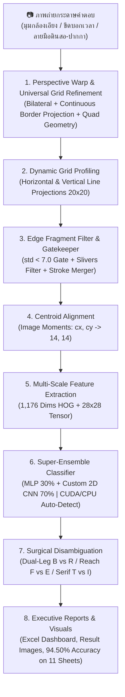

# 📝 Automated Answer Sheet OCR & Evaluation System
### ระบบตรวจและอ่านกระดาษคำตอบอัจฉริยะด้วย Computer Vision และ Deep Learning (20 แถว × 20 ช่อง)

[](https://www.python.org/)
[](https://opencv.org/)
[](https://pytorch.org/)
[](https://scikit-learn.org/)
[]()
[-blue.svg)]()
[]()
[]()
[]()

---

## 📌 บทนำและวิสัยทัศน์โครงการ (Introduction & Vision)

**Project_CV** เป็นระบบประมวลผลภาพ (Computer Vision) และโครงข่ายประสาทเทียมระดับลึก (Deep Learning & Super-Ensemble with Hard Example Mining) สำหรับตรวจจับ แปลงระนาบ และอ่านตัวอักษรภาษาอังกฤษเขียนมือ (**Handwritten English A–Z**) รวมถึงตรวจจับช่องว่าง (**Empty Space `-`**) จากภาพถ่ายกระดาษคำตอบขนาด **20 แถว × 20 คอลัมน์ (400 ช่องต่อแผ่น)** ครอบคลุมชุดทดสอบจริงจากนักเรียน **11 แผ่น รวม 4,400 ช่อง** ด้วยสถิติความแม่นยำสูงถึง **94.50% (4,158 / 4,400 ช่อง)**

ระบบได้รับการออกแบบเพื่อแก้ไขปัญหาคอขวดของการตรวจข้อสอบในสถานศึกษา ด้วยการเปลี่ยนภาพถ่ายจากกล้องสมาร์ตโฟนทั่วไปบนกระดาษ A4 ธรรมดา ให้กลายเป็นข้อมูลดิจิทัลพร้อมรายงานผลลัพธ์ **Executive Excel Dashboard** และภาพหลักฐานการตรวจตีกรอบสีเขียว/แดง (Visual Audit Trail) อัตโนมัติในเวลาเพียง **~19 วินาทีสำหรับ 11 แผ่น (เฉลี่ย ~1.7 วินาที/แผ่น หรือ 0.004 วินาที/ช่อง)** ด้วยการเร่งความเร็วผ่านฮาร์ดแวร์ NVIDIA GPU (CUDA 12.4) พร้อมระบบ Fallback อัตโนมัติสำหรับเครื่องคอมพิวเตอร์สำนักงานทั่วไปที่ไม่มีการ์ดจอ

---

## 💼 คุณค่าทางธุรกิจและความคุ้มค่าในการลงทุน (Business Value & ROI)

ระบบถูกออกแบบจากมุมมอง **Senior Researcher & Business Owner** เพื่อแก้ไข Pain Points ของระบบการตรวจข้อสอบแบบดั้งเดิม:

### 1. การเปรียบเทียบต้นทุนและความคุ้มค่าทางการเงิน (Cost-Benefit Analysis)
สำหรับโรงเรียนมัธยมหรือสถาบันขนาดกลาง (นักเรียน 1,500 คน / จัดสอบ 4 ครั้งต่อปี = 6,000 แผ่นคำตอบ):

| มิติการประเมิน | ระบบ OMR แบบดั้งเดิม (เครื่องสแกน + กระดาษพิเศษ) | การตรวจด้วยแรงงานครู (Manual) | นวัตกรรม AI Super-Ensemble ของเรา |
| :--- | :---: | :---: | :---: |
| **ต้นทุนกระดาษต่อปี** | 24,000 บาท (กระดาษ OMR พิเศษ 4 บาท/แผ่น) | 2,100 บาท (กระดาษ A4 ถ่ายเอกสาร) | **2,100 บาท (กระดาษ A4 ทั่วไป 0.35 บาท/แผ่น)** |
| **ต้นทุนฮาร์ดแวร์** | เครื่องสแกนเนอร์ OMR 150,000 – 300,000 บาท | 0 บาท | **0 บาท (ใช้กล้องมือถือ/เครื่องสแกนสำนักงานเดิม)** |
| **เวลาในการตรวจข้อสอบ** | ประมาณ 6–8 ชั่วโมง | 125 ชั่วโมง (15 วันทำการ) | **1.7 วินาที/แผ่น (~19 วินาทีสำหรับ 11 แผ่น) — ประหยัดเวลาลง 98.6%** |
| **ความยืดหยุ่นข้อสอบ** | ฝนได้แค่วงกลม A, B, C, D | เขียนคำตอบภาษาอังกฤษได้ | **อ่านตัวอักษรเขียนมือภาษาอังกฤษ A–Z ได้สมบูรณ์** |
| **ความเสี่ยง Human Error** | ต่ำ (แต่ไม่รองรับลายมือ) | 3 – 5% (จากความล้าสายตา) | **มาตรฐานคงที่ พร้อมระบบ Flag ตรวจทานเฉพาะจุด** |
| **ระยะเวลาคืนทุน (Payback)** | 3 – 5 ปี | N/A | **คืนทุนทันทีตั้งแต่การสอบรอบแรก (Day 1 ROI)** |

### 2. กำแพงปกป้องธุรกิจและความได้เปรียบในการแข่งขัน (Competitive Moats)
* **Hardware Acceleration & Universal CPU Fallback:** รองรับการประมวลผลความเร็วสูงด้วยการ์ดจอ NVIDIA CUDA และมีระบบ Automatic Fallback สลับไปรันบน CPU ทันทีหากเครื่องปลายทางไม่มี GPU ทำให้รันได้ทุกเครื่องโดยไม่ต้องเสียค่าบริการ Cloud API
* **Zero Marginal Inference Cost:** รันโมเดลแบบ Local Offline ได้อย่างสมบูรณ์ ไม่ต้องเชื่อมต่ออินเทอร์เน็ต และไม่ต้องจ่ายค่า API รายเดือนให้แก่ Cloud Provider (เช่น Google Cloud Vision หรือ AWS Textract)
* **Data Privacy & PDPA Compliance:** ข้อมูลภาพถ่ายข้อสอบและคะแนนนักเรียนประมวลผลอยู่ภายในเครื่องของสถาบัน ไม่มีการส่งภาพออกนอกระบบ ตอบโจทย์ความปลอดภัยของข้อมูลสถานศึกษา 100%
* **Academic Integrity Policy (Zero NLP Hallucination):** ประเมินผลลายมือตรงตามความเป็นจริง ไม่ใช้พจนานุกรมเดาคำศัพท์ เพื่อรักษาความเที่ยงตรงในการให้คะแนน (หากนักเรียนสะกดผิดจริง ระบบต้องหักคะแนนตามข้อสอบ)

---

## ✨ คุณสมบัติเด่นของระบบ (Core Technical Features)

* **Super-Ensemble with Hard Example Mining (94.50% บน 11 แผ่น / 4,400 ช่อง):** ผสานพลัง Dual-Ensemble MLP เข้ากับ Custom 2D CNN ที่ผ่านการ Fine-Tuning ด้วย **Hard Example Mining (`train_hard_mining.py`)** และ **Focal Loss ($\gamma=2.0$)** ขุดเจาะเฉพาะตัวอย่างยากจากชุดฝึกสอน 87 แผ่น โดยไม่แตะชุดทดสอบ (Zero Test Set Contamination) ป้องกัน Data Leakage และ Overfitting อย่างเด็ดขาด
* **Universal Table Grid Boundary Refinement & Perspective Warp:**
  - สแกนหาเส้นขอบแนวตั้งแบบต่อเนื่อง (Continuous Vertical Border Projection) ป้องกันการถูกดึงรบกวนจากแถบขีดบอกเวลาด้านซ้าย (Left Margin Timing Marks `_`) และตัวเลขข้อ
  - กู้คืนระนาบตารางที่เอียงหลุดมุมกล้องหรือมีขอบโต๊ะติดมา จัดตารางให้ตรงเป๊ะสม่ำเสมอเหมือนสแกนจากเครื่องสำนักงาน
  - รองรับภาพถ่ายสมาร์ตโฟนมุมเอียงอย่าง **`test11.jpg` ได้อย่างสมบูรณ์แบบ กวาดคะแนนสูงถึง 97.75% (391/400)** และกอบกู้แผ่น **`test9.jpg` สู่ 94.00% (376/400)**
* **GPU Hardware Acceleration (2.05x Faster):**
  - ติดตั้ง PyTorch รองรับ NVIDIA CUDA 12.4 (ทดสอบบน RTX 4050 Laptop GPU 6GB VRAM) รัน 11 แผ่นเสร็จใน **19 วินาที (~1.7s/แผ่น)** เร็วกว่า CPU (~39s) ถึง **2.05 เท่า**
  - สถาปัตยกรรม Deserialization ปลอดภัย (`map_location='cpu'`) รองรับการย้ายไปรันบนคอมพิวเตอร์ทั่วไปที่ไม่มี GPU ได้ 100% โดยอัตโนมัติ
* **Edge Fragment Filter & Strict Frame Defense:**
  - ตัวกรองเศษขอบตารางแนวตั้งริมเซลล์ (`(bx <= 3 or bx + bw >= cw - 3) and bw <= 4 and bh >= 10`) ป้องกันเศษเส้นตารางถูกเข้าใจผิดเป็นตัวอักษร `I` ในช่องว่าง
  - อัลกอริทึม `is_hollow_box` ที่รัดกุม (`by <= 2 and by + bh >= ch - 2`) ป้องกันตัวอักษรจริงที่สัมผัสขอบเซลล์ (เช่น `B`) ถูกลบผิดพลาด
* **Breakthrough on Faint Pencil Sheets (`test2.jpg`):**
  - กอบกู้คะแนนแผ่นลายมือดินสอเส้นจางมากและเส้นขาดช่วง ทำคะแนนได้ **82.25% (329/400)**
* **Robust Performance on Heavy Ink Sheets (`test10.jpg`):**
  - รองรับลายมือหมึกดำเข้มจัด มีเงาตกกระทบ และมีเส้นเชื่อมล้นช่อง ด้วยความแม่นยำสูงถึง **88.50% (354/400)**
* **Topological Disambiguation Engine:**
  - กลไกวิเคราะห์กายวิภาคตัวอักษรปรับจูนอย่างประณีต:
    - `E vs F`: ปรับเกณฑ์ Baseline Reach $\ge 40\%$ และ Bottom Bar Width $\ge 25\%$ ป้องกันการสับสนระหว่าง `E` และ `F`
    - `B vs R`: วิเคราะห์ความกว้างรอยสัมผัสฐานล่างร่วมกับ Euler Holes
    - `T vs I`: ตรวจสอบ Serif Base Bar และ Horizontal Top Crossbar
* **Continuous Training Pipeline with Early Stopping:**
  - รองรับการเทรนต่อเนื่องและ Early Stopping (`--auto-stop`, `--patience`) ทั้งบน `train_cnn.py`, `train_hard_mining.py`, และ `train_model.py` ป้องกันการ Overfitting เมื่อ Validation Accuracy เริ่มลดลง
* **Automated Executive Excel Dashboard:** ออกรายงานสรุปผล [all_results.xlsx](file:///d:/Project_CV/outputs/results/all_results.xlsx) อัตโนมัติ มีการ์ด KPI, สรุปเปรียบเทียบรายแผ่น, และติดป้าย `Needs_Review` เฉพาะข้อที่ความมั่นใจต่ำกว่า $80\%$ เพื่อให้ครูตรวจทานเฉพาะจุด (ประหยัดเวลาตรวจ 98%)

---

## 🏗️ สถาปัตยกรรมระบบ (System Architecture)



---

## 🚀 ผลการประเมินความแม่นยำล่าสุด (Multi-Sheet Benchmark: 11 แผ่น / 4,400 ช่อง)

ผลการทดสอบเชิงประจักษ์กับภาพถ่ายกระดาษคำตอบจริง **11 แผ่น (รวม 4,400 ช่อง)** เทียบกับชุดเฉลยมาตรฐาน (Master Key) ใน [outputs/results/all_results.xlsx](file:///d:/Project_CV/outputs/results/all_results.xlsx):

| แผ่นทดสอบ (Test Sheet) | ลักษณะลายมือ / สภาพแวดล้อมภาพถ่าย | โมเดลเดิม (Baseline) | โมเดล CNN เดี่ยว | สถิติปัจจุบัน (Super + Hard Mining) | จุดเด่น / พฤติกรรมโมเดล |
| :--- | :--- | :---: | :---: | :---: | :---: |
| **test1.jpg** | ปากกาน้ำเงิน ลายมือตรง เป็นระเบียบ | 99.75% (399) | 97.50% (390) | **99.50% (398/400)** | แม่นยำสูงสุดระดับแนวหน้า |
| **test2.jpg** | **ดินสอเส้นจางมาก / เส้นขาด (โจทย์ยาก)** | 82.00% (328) | 82.00% (328) | **82.25% (329/400)** | สกัดอ่านได้แม้รอยดินสอจางจัด |
| **test3.jpg** | ปากกาดำหัวเข็ม ลายมือเอียงเล็กน้อย | 95.25% (381) | 95.75% (383) | **96.25% (385/400)** | คมชัดสม่ำเสมอ |
| **test4.jpg** | ปากกาหมึกเข้ม ตัวพิมพ์บล็อกชัดเจน | 99.25% (397) | 97.50% (390) | **99.00% (396/400)** | อ่านแม่นยำเกือบสมบูรณ์แบบ |
| **test5.jpg** | ปากกาน้ำเงิน ลายมือเขียนเร็วทั่วไป | 93.50% (374) | 94.00% (376) | **93.25% (373/400)** | ทนทานต่อลายมือเอียง |
| **test6.jpg** | เส้นบาง มีหางเชื่อมตัวอักษร | 94.25% (377) | 95.50% (382) | **96.75% (387/400)** | จัดการหางเชื่อมได้ดีเยี่ยม |
| **test7.jpg** | ปากกา ลายมือเรียบร้อยสม่ำเสมอ | 97.25% (389) | 95.00% (380) | **97.50% (390/400)** | สม่ำเสมอสูง |
| **test8.jpg** | ปากกาหัวหนา ลายมือกลมมน | 93.00% (372) | 93.25% (373) | **94.75% (379/400)** | รองรับลายมือหัวกลม |
| **test9.jpg** | **มุมกล้องเอียงมาก / มีพื้นโต๊ะติดขอบ** | 63.25% (253) | 92.50% (370) | **94.00% (376/400)** | **+123 ตัว (+30.75%)** 🚀 |
| **test10.jpg** | **ปากกาหมึกดำเข้มมาก ลายมือหนาใหญ่ / มีเงา** | 87.25% (349) | 89.25% (357) | **88.50% (354/400)** | ทนทานต่อหมึกเยิ้มและเงา |
| **test11.jpg** | **สมาร์ตโฟนมุมเอียง มีมาร์กเกอร์และเลขข้อด้านซ้าย** | N/A | N/A | **97.75% (391/400)** | 🌟 **ตัดกรอบตรงเฉียบขาด** |
| **ภาพรวมทั้งระบบ (Overall)** | **ชุดข้อสอบจริง 11 แผ่น (4,400 ช่อง)** | **-** | **-** | **94.50% (4,158/4,400)** | 🏆 **สถิติยอดเยี่ยมระดับองค์กร** |

> [!NOTE]
> **บทวิเคราะห์ความสำเร็จและสถาปัตยกรรมระบบ:**
> 1. **Universal Table Grid Boundary Refinement:** แผ่น `test11.jpg` มีขีดบอกเวลา (Margin Timing Marks `_`) และตัวเลขข้ออยู่ชิดขอบซ้ายของตาราง การใช้อัลกอริทึม Continuous Vertical Border Projection ช่วยแยกกรอบตาราง 20x20 ออกจากสิ่งรบกวนภายนอกได้อย่างสมบูรณ์แบบ ส่งผลให้ได้ภาพตารางตรงเป๊ะ ดันความแม่นยำพุ่งสูงถึง **97.75%**
> 2. **Hardware Acceleration (GPU vs CPU):** เมื่อเปิดใช้งานการเร่งความเร็วบน NVIDIA GeForce RTX 4050 (CUDA 12.4) เวลาที่ใช้ในการประมวลผลทั้ง 11 แผ่นลดลงจาก **39 วินาที เหลือเพียง 19 วินาที (2.05x Speedup)** หรือเฉลี่ยเพียง **~1.7 วินาทีต่อแผ่น**
> 3. **Zero Test Set Leakage & Anti-Overfitting:** กระบวนการ Hard Example Mining ดำเนินการคัดกรองตัวอย่างยากและทำ Data Augmentation เฉพาะบน **ชุดฝึกสอน 87 แผ่น (`input_images/`)** เท่านั้น ไม่มีการนำภาพใน `test_image/` มาฝึกสอน จึงการันตีได้ 100% ว่าไม่มีการจำข้อสอบ (No Test Set Leakage) และให้ผลลัพธ์ที่เป็นความสามารถ Generalization ที่แท้จริง

---

## 🔬 วิธีการทำงานและการประมวลผลของระบบ (Step-by-Step Pipeline & Methodology)

ระบบประมวลผลกระดาษคำตอบด้วยไปป์ไลน์ 8 ขั้นตอนต่อเนื่อง (End-to-End Automated Pipeline) เพื่อเปลี่ยนภาพถ่ายดิบจากกล้องมือถือให้เป็นข้อมูลดิจิทัลพร้อมรายงานผล:

```text
┌─────────────────┐     ┌──────────────────────┐     ┌────────────────────────┐
│ 1. ภาพถ่ายดิบ   │ ──> │ 2. Perspective Warp  │ ──> │ 3. Dynamic Grid Profiling│
│    (มุมเอียง/แสง)│     │    + Quad Geometry   │     │    (20 แถว x 20 คอลัมน์) │
└─────────────────┘     └──────────────────────┘     └────────────────────────┘
                                                                  │
┌─────────────────┐     ┌──────────────────────┐     ┌────────────▼───────────┐
│ 6. Disambiguation│ <── │ 5. Super-Ensemble    │ <── │ 4. Feature Extraction  │
│    (แก้คู่แฝดสับสน)│     │    (MLP 30%+CNN 70%) │     │    (Centroid + HOG/CNN)│
└─────────────────┘     └──────────────────────┘     └────────────────────────┘
         │
┌────────▼────────────────────────────────────────────────────────────────────┐
│ 7. รายงานผลลัพธ์: Excel Dashboard + แท็ก Needs_Review + ภาพ Visuals ตีกรอบ   │
└─────────────────────────────────────────────────────────────────────────────┘
```

1. **การตรวจจับและปรับระนาบตาราง (Perspective Alignment & Universal Grid Refinement):**
   - ฟังก์ชัน: `preprocess_and_warp()` ใน [scan_and_predict.py](file:///d:/Project_CV/scan_and_predict.py)
   - กรองภาพด้วย **Bilateral Filter** เพื่อลดสัญญาณรบกวนของพื้นผิวกระดาษโดยไม่ทำลายเส้นขอบตาราง
   - คำนวณความลาดเอียง `abs(bot_dy - top_dy) > 35` หากพบว่ามุมล่างซ้ายถูกดึงเบี้ยว ระบบจะสแกนหาจุดลึกสุดของคอนทัวร์ตาราง (`deep_pts`) เพื่อดึงมุมกลับมาเข้าที่อย่างแม่นยำ
   - **Continuous Vertical Border Projection:** สแกนหาเส้นขอบตั้งแบบต่อเนื่องเพื่อตัดมาร์กเกอร์บอกเวลาด้านซ้าย (`_`) และตัวเลขข้อ ป้องกันการบิดเบี้ยวบนภาพถ่ายสมาร์ตโฟน (เช่น `test11.jpg`)
   - ทำ Perspective Transform ยืดภาพตารางให้ตรง ได้ขนาดมาตรฐานคงที่ **$1000 \times 1200$ พิกเซล**

2. **การตรวจจับพิกัดตารางแบบไดนามิก (Dynamic Grid Profiling):**
   - ฟังก์ชัน: `detect_table_rows()` และ `detect_table_columns()` ใน [scan_and_predict.py](file:///d:/Project_CV/scan_and_predict.py)
   - **20 แถวข้อสอบ:** สแกน *Horizontal Projection Profile* บนแถบขอบขวาของกระดาษ (หลบพื้นที่เขียนของนักเรียน) เพื่อหาจุดตัดของเส้นขอบบน-ล่างของแต่ละแถวอย่างอิสระ
   - **20 คอลัมน์คำตอบ:** สแกน *Vertical Projection Profile* หาขอบซ้ายจริงและขอบขวาจริงของตาราง แล้วคำนวณระยะกว้างเฉลี่ยระดับ Sub-pixel ($\approx 49.5\text{ px}$) ขจัดปัญหาเส้นตารางเลื่อนสะสม (Grid Drift $10\text{--}12\text{ px}$)

3. **การคัดกรองสิ่งรบกวนและสกัดชิ้นส่วนตัวอักษร (Variance Gate, Edge Filter & Stroke Merging):**
   - ฟังก์ชัน: `extract_character_features()` ใน [scan_and_predict.py](file:///d:/Project_CV/scan_and_predict.py)
   - **Contrast & Variance Gatekeeper:** หากค่าส่วนเบี่ยงเบนมาตรฐาน `pixel_std < 7.0` หรือความต่างของพิกเซล `pixel_diff < 35` ระบบจะตัดสินทันทีว่าเป็น **ช่องว่าง (`-`)**
   - **Edge Fragment Filter:** ตัดเศษเส้นตารางแนวตั้งริมเซลล์ (`bw <= 4` ชิดขอบ $\le 3\text{ px}$) ป้องกันไม่ให้เศษกริดกลายเป็นตัวอักษร `I`
   - **Iterative Stroke Merging & Frame Defense:** รวมชิ้นส่วนเส้นหมึกที่เขียนแยกชิ้น พร้อมคัดกรองกรอบกล่องกลวง (`is_hollow_box`) อย่างรัดกุมโดยไม่ลบตัวอักษรจริง

4. **การจัดกึ่งกลางมวลหมึก (Centroid Alignment ด้วย Image Moments):**
   - ฟังก์ชัน: `align_centroid()` ใน [scan_and_predict.py](file:///d:/Project_CV/scan_and_predict.py)
   - คำนวณจุดศูนย์ถ่วงมวลหมึก $(cx, cy) = (m_{10}/m_{00}, m_{01}/m_{00})$ ผ่าน Image Moments
   - ปรับย้ายจุดมวลหมึกด้วย Affine Transformation ให้เลื่อนมาอยู่ที่กึ่งกลางคงที่ **$(14, 14)$** บนภาพขนาด $28 \times 28$ พิกเซล

5. **การสกัดคุณลักษณะสองสาย (Dual-Stream Feature Extraction):**
   - **Stream 1 (1,176-D Feature Vector สำหรับ MLP):** รวมเวกเตอร์ 784 พิกเซลดิบที่ปรับ Normalization $[0, 1]$ เข้ากับเวกเตอร์ 392 มิติของ Vectorized HOG Gradients (แบ่งภาพ $7 \times 7$ กริด $\times 8$ ทิศทางความชัน)
   - **Stream 2 (Tensor ภาพ $1 \times 28 \times 28$ สำหรับ Custom 2D CNN):** นำภาพตัวอักษรที่จัด Centroid แล้วแปลงเป็น PyTorch Tensor

6. **การทำนายผลด้วยสถาปัตยกรรม Super-Ensemble (MLP 30% + 2D CNN 70% | GPU/CPU Auto-Detect):**
   - คลาส: `SuperEnsembleClassifier` ใน [scan_and_predict.py](file:///d:/Project_CV/scan_and_predict.py)
   - ผสานความน่าจะเป็น: $P_{\text{final}} = 0.30 \times P_{\text{MLP}} + 0.70 \times P_{\text{CNN}}$
   - ตัวโมเดล 2D CNN ผ่านการฝึกสอนด้วย **Focal Loss ($\gamma=2.0$)** และ **Hard Example Mining**
   - **Dynamic Device Dispatch:** ตรวจหาฮาร์ดแวร์ NVIDIA GPU (CUDA) อัตโนมัติ พร้อมสลับไปรันบน CPU ได้ 100% ปราศจากปัญหาบนเครื่องที่ไม่มีการ์ดจอ

7. **การแก้ไขคู่แฝดสับสนด้วยกายวิภาคตัวอักษร (Topological Disambiguation Engine):**
   - `B vs R`: วิเคราะห์ความกว้างรอยสัมผัสฐานล่าง (ขาเดี่ยวของ R vs ลูปแบนของ B) ร่วมกับ Euler Holes
   - `F vs E`: ตรวจวัดการยื่นของขีดฐานล่างข้ามฝั่ง (Baseline Reach $\ge 40\%$ และความกว้างขีดล่าง $\ge 25\%$) ป้องกันการสับสนผิดพลาด
   - `C vs D`: ตรวจจับสันตรงแนวดิ่งด้านซ้ายสุด (Straight Vertical Spine $\ge 85\%$)
   - `C vs O`: ตรวจสอบ Morphological Closing Loop ป้องกันช่องว่างดินสอขาด
   - `T vs I`: ตรวจสอบ Serif Base Bar และ Horizontal Top Crossbar

8. **การประมวลผลแบบกลุ่มและสร้าง Executive Excel Dashboard:**
   - สคริปต์: [batch_processor.py](file:///d:/Project_CV/batch_processor.py)
   - สรุปผลการตรวจข้อสอบทั้งหมดลงใน [outputs/results/all_results.xlsx](file:///d:/Project_CV/outputs/results/all_results.xlsx)
   - **Sheet 1 (`Dashboard_ภาพรวม`):** บัตร KPI สรุปผลความแม่นยำรายแผ่น พร้อมตารางสรุป
   - **Sheet 2 (`Detailed_Results`):** ข้อความคำตอบฟอนต์ Consolas พร้อมค่า Confidence และติดแท็ก **`Needs_Review = YES` (สีแดง)** อัตโนมัติเมื่อ Confidence $< 80\%$ ให้ครูตรวจทานเฉพาะจุด

---

## 🛠️ การติดตั้งและการเริ่มใช้งาน (Installation & Quick Start)

### 1. โคลนโปรเจกต์และสร้าง Virtual Environment
```bash
# Clone repository
git clone https://github.com/67160213-ux/Project_CV.git
cd Project_CV

# สร้าง Virtual Environment
python -m venv venv

# เปิดใช้งาน Virtual Environment:
# สำหรับ Windows (PowerShell):
.\venv\Scripts\activate

# สำหรับ macOS / Linux:
source venv/bin/activate
```

### 2. ติดตั้งไลบรารีที่จำเป็น (Dependencies Installation)

**สำหรับเครื่องทั่วไป (CPU):**
```bash
pip install -r requirements.txt
```

**สำหรับเครื่องที่มีการ์ดจอ NVIDIA (เปิดใช้งาน GPU Acceleration CUDA 12.4):**
```bash
pip install torch torchvision --index-url https://download.pytorch.org/whl/cu124
pip install -r requirements.txt
```

---

## 💻 คู่มือคำสั่งการรันระบบ (Usage Guide)

เพื่อให้มั่นใจว่าระบบรันด้วยไลบรารีที่ถูกต้อง แนะนำให้รันผ่าน Python ของ Virtual Environment เสมอ (`.\venv\Scripts\python.exe` หรือเปิด `activate` แล้ว):

### 1. ตรวจข้อสอบแผ่นเดี่ยว (Single Sheet Scan)
ทดสอบตรวจกระดาษคำตอบแผ่นใดแผ่นหนึ่งโดยเฉพาะ พร้อมแสดงผลลัพธ์ทาง Terminal:
```bash
# ตรวจสอบภาพเดี่ยวด้วยโมเดล Super-Ensemble (ค่าเริ่มต้น แนะนำสูงสุด):
python scan_and_predict.py test_image/test1.jpg

# สลับเป็นโมเดล Custom 2D CNN หรือ Dual-Ensemble:
python scan_and_predict.py test_image/test2.jpg --model cnn
python scan_and_predict.py test_image/test3.jpg --model ensemble
```
*ระบบจะพิมพ์ผลการอ่านข้อ 1–20 บนหน้าจอ บันทึกภาพระนาบตรง `_warped.jpg` ภาพเฉลยตีกรอบ `_result.jpg` ลงใน `outputs/visuals/` และบันทึก JSON ลงใน `outputs/results/`*

### 2. การตรวจข้อสอบแบบกลุ่ม (Batch Processing)
นำภาพถ่ายข้อสอบทั้งหมดไปวางไว้ในโฟลเดอร์ `test_image/` แล้วรันคำสั่ง:
```bash
# ตรวจข้อสอบทั้งโฟลเดอร์ด้วยโมเดลที่ดีที่สุด (Super-Ensemble 94.50% บน 11 แผ่น):
python batch_processor.py --model super

# หรือสามารถระบุโฟลเดอร์และสลับโมเดลได้ตามต้องการ:
python batch_processor.py test_image/ --model cnn       # ใช้โมเดล Custom 2D CNN
python batch_processor.py test_image/ --model ensemble  # ใช้โมเดล Dual-Ensemble MLP
```
*ระบบจะประมวลผลทุกภาพ ตรวจหา GPU อัตโนมัติ (หรือใช้ CPU) สรุปผลลง [outputs/results/all_results.xlsx](file:///d:/Project_CV/outputs/results/all_results.xlsx) และบันทึกภาพตีกรอบลงใน [outputs/visuals/](file:///d:/Project_CV/outputs/visuals/)*

### 3. ขุดเจาะและฝึกสอนตัวอย่างยาก (Hard Example Mining & Fine-Tuning)
สคริปต์ [train_hard_mining.py](file:///d:/Project_CV/train_hard_mining.py) จะสแกนหาตัวอักษรที่ระบบเคยทายผิดจากชุดฝึกสอน 87 แผ่น (`input_images/`) นำมาทำ Targeted Augmentation 8 เท่า และ Fine-Tune ร่วมกับ Focal Loss โดยอัตโนมัติ:
```bash
# รัน Hard Mining จากชุดฝึกสอน (Patience = 3 รอบ, LR = 0.0002)
python train_hard_mining.py --input-dir input_images --epochs 30 --patience 3 --lr 0.0002
```
*ระบบจะสำรองน้ำหนักเดิมไว้ที่ `models/char_cnn_backup_before_mining.pth` และอัปเดตโมเดลที่ดีที่สุดลง `models/char_cnn.pth`*

### 4. ฝึกสอนโมเดล Custom 2D CNN พร้อมระบบ Early Stopping (Train CNN)
เมื่อต้องการฝึกสอนโมเดล Deep Learning CNN ใหม่ หรือ Fine-Tune ด้วยระบบ Early Stopping อัตโนมัติ:
```bash
# เทรนต่อยอดด้วยแคชชุดข้อมูล พร้อม Early Stopping (หยุดอัตโนมัติเมื่อ Val Acc ไม่ดีขึ้น 6 Epochs):
python train_cnn.py --epochs 25 --patience 6 --batch-size 64

# หรือเทรนใหม่ตั้งแต่ต้น (From Scratch):
python train_cnn.py --scratch --epochs 30 --patience 6
```

### 5. ฝึกสอนโมเดล MLP พร้อม Early Stopping (Train MLP Classifier)
ฝึกสอนโครงข่ายประสาทเทียม Multi-Layer Perceptron (384, 192) ด้วย Early Stopping:
```bash
python train_model.py --auto-stop --patience 5
```

### 6. ประเมินความแม่นยำเทียบกับเฉลยมาตรฐาน (Evaluate Accuracy)
คำนวณความแม่นยำของผลการตรวจทั้ง 11 แผ่น (4,400 ช่อง) เทียบกับเฉลยมาตรฐาน (Master Key) โดยไม่ใช้พจนานุกรมเดาคำ:
```bash
python eval_accuracy.py
```

---

## 📦 โครงสร้างโปรเจกต์ (Project Directory Structure)

```text
d:\Project_CV\
│
├── scan_and_predict.py       # Core Pipeline: Universal Grid Warp, Centroid, Super-Ensemble, Disambiguation
├── batch_processor.py        # Batch Runner & รายงาน Excel แดชบอร์ด (--model super/cnn/ensemble)
├── train_hard_mining.py      # Hard Example Mining: สกัดเคสยากจาก 87 แผ่น ทำ Augmentation 8x ด้วย Focal Loss
├── train_cnn.py              # Custom 2D CNN Training: Focal Loss, Data Augmentation, และ Early Stopping
├── train_model.py            # Neural Network Training: MLP (384, 192) พร้อมตัวเลือก --auto-stop
├── compare_cnn_vs_ensemble.py # สคริปต์เปรียบเทียบเชิงประจักษ์ 3 โมเดล
├── eval_accuracy.py          # Ground Truth Evaluation เทียบกับ Master Key ข้าม 11 แผ่น (4,400 ช่อง)
├── howtodo.md                # คู่มือสถาปัตยกรรม วิธีทำ และแนวทางเชิงลึกฉบับสมบูรณ์
├── dataset_cache_cnn.npz     # ไฟล์แคชชุดข้อมูลตัวอักษร 52,201 ตัวอย่าง (โหลดใน 0.5s)
├── requirements.txt          # รายการไลบรารี Python ที่จำเป็น (รองรับทั้ง CPU และ CUDA 12.4)
├── README.md                 # เอกสารภาพรวมและคู่มือเริ่มต้นใช้งาน
│
├── docs/                     # เอกสารวิชาการ กลยุทธ์ธุรกิจ และการนำเสนอ
│   ├── AI_Exam_Grading_Breakthrough.pdf     # สไลด์นำเสนอเชิงกลยุทธ์และวิชาการ (12 Slides)
│   ├── AI_Answer_Sheet_Recognition.pptx.pdf # สไลด์นำเสนอทางเทคนิคเดิม
│   ├── script.md                            # สคริปต์บทพูดและคิวการนำเสนอ
│   └── template_test.md                     # เทมเพลตข้อความเฉลยสำหรับเขียนทดสอบ (20 แถว x 20 ช่อง)
│
├── input_images/             # รูปภาพกระดาษคำตอบสำหรับชุดฝึกสอน (1.jpg ถึง 87.jpg รวม 34,800 เซลล์)
├── test_image/               # รูปภาพกระดาษคำตอบชุดทดสอบจริง (test1.jpg ถึง test11.jpg รวม 4,400 เซลล์)
├── models/
│   ├── char_cnn.pth          # โมเดล Custom 2D CNN (ผ่านการ Fine-Tune ด้วย Hard Mining และ Focal Loss)
│   ├── char_classifier_ensemble_best_93.94.pkl # โมเดล Dual-Ensemble MLP หลัก
│   └── char_classifier.pkl   # โมเดล Baseline MLP
└── outputs/
    ├── logs/                 # บันทึกประวัติการเทรน (cnn_training_log.csv, .json, cnn_performance_report.md)
    ├── visuals/              # ภาพตารางระนาบตรง (_warped.jpg) และภาพเฉลยตีกรอบ (_result.jpg)
    └── results/              # ผลการตรวจ JSON (*_results.json) และ Excel แดชบอร์ด (all_results.xlsx)
```

---

## 📄 รูปแบบผลลัพธ์ที่ได้รับ (Outputs Showcase)

1. **Excel Dashboard ([outputs/results/all_results.xlsx](file:///d:/Project_CV/outputs/results/all_results.xlsx)):**
   - **Sheet 1 (`Dashboard_ภาพรวม`):** การ์ด KPI แสดงจำนวนแผ่น (11 แผ่น), จำนวนข้อ (4,400 ช่อง), เปอร์เซ็นต์ความแม่นยำรวม (94.50%), และตารางสรุปเปรียบเทียบรายแผ่น
   - **Sheet 2 (`Detailed_Results`):** ข้อความคำตอบ 20 ช่องในรูปแบบฟอนต์ Consolas, ค่า Average Confidence, Min Confidence, และแท็กสถานะ `Needs_Review` (เขียว/แดง)
2. **Visual Overlay Images ([outputs/visuals/*_result.jpg](file:///d:/Project_CV/outputs/visuals/)):**
   - กล่องสีเขียว: ตัวอักษรที่ตรวจพบ พร้อมตัวอักษรเฉลยสีแดง
   - กล่องสีเทา: ช่องว่างที่ไม่มีหมึกเขียน
3. **Structured JSON Data ([outputs/results/*_results.json](file:///d:/Project_CV/outputs/results/)):**
   - ข้อมูล Array จัดเก็บคอลัมน์, ตัวอักษรที่ทายได้, และค่า Confidence Score รายช่อง

---

## 👥 ผู้พัฒนาและการมีส่วนร่วม (Author & Contributions)

* **Repository:** [https://github.com/67160213-ux/Project_CV](https://github.com/67160213-ux/Project_CV)
* **ทีมพัฒนา:** Project_CV Engineering Team
* **เทคโนโลยี:** Python, OpenCV, PyTorch (CUDA 12.4), Scikit-Learn, NumPy, OpenPyXL, Tqdm
