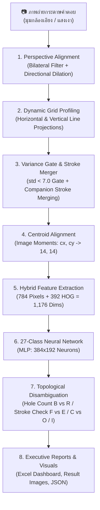

# 📝 Automated Answer Sheet OCR & Evaluation System
### ระบบตรวจและอ่านกระดาษคำตอบอัจฉริยะด้วย Computer Vision และ Machine Learning (20 แถว × 20 ช่อง)

[](https://www.python.org/)
[](https://opencv.org/)
[](https://scikit-learn.org/)
[]()
[]()
[]()

---

## 📌 บทนำ (Introduction)

**Project_CV** เป็นระบบประมวลผลภาพ (Computer Vision) และโครงข่ายประสาทเทียม (Deep Learning / Multi-Layer Perceptron) สำหรับตรวจจับ แปลงระนาบ และอ่านตัวอักษรภาษาอังกฤษเขียนมือ (**Handwritten English A–Z**) รวมถึงตรวจจับช่องว่าง (**Empty Space `-`**) จากภาพถ่ายกระดาษคำตอบขนาด **20 แถว × 20 คอลัมน์ (400 ช่องต่อแผ่น)** ครอบคลุมชุดทดสอบจริง **6 แผ่น รวม 2,400 ช่อง** ด้วยสถิติความแม่นยำระดับ **92.08%**

ระบบได้รับการออกแบบให้รองรับภาพถ่ายจากกล้องสมาร์ตโฟนทั่วไปที่มีมุมมองเอียง แสงเงาไม่สม่ำเสมอ และความหลากหลายของลายมือมนุษย์ (ทั้งปากกาหมึกซึม ปากกาลูกลื่น ปากกาเจล และดินสอเส้นบาง) พร้อมระบบสร้างรายงานผลลัพธ์ในรูปแบบ **Executive Excel Dashboard** และภาพหลักฐานตีกรอบสีเขียว/แดง (Visual Bounding Boxes) อัตโนมัติ

---

## ✨ คุณสมบัติเด่น (Key Features)

* **Robust Perspective Alignment:** ตรวจจับกรอบตาราง 20×20 และดึงภาพให้ตรงด้วย *Bilateral Filter* ร่วมกับ *Directional Vertical Dilation* ขจัดปัญหาตารางเบี้ยวจากการเชื่อมติดแถบมาร์กเกอร์สีดำ
* **Dynamic Grid Profiling (Rows & Columns):**
  - **Dynamic Row Detection:** คำนวณความสูงของแต่ละแถวข้อสอบทั้ง 20 แถวอย่างเป็นอิสระด้วย *Horizontal Line Projection*
  - **Dynamic Column Detection:** สแกนหาขอบเขตตารางซ้าย–ขวาจริง และคำนวณคอลัมน์เฉลี่ยแม่นยำ ขจัดปัญหาเส้นตารางเลื่อนสะสม (Grid Drift) คอลัมน์ 10–19 ได้ $100\%$
* **Contrast & Variance Gatekeeper:** ด่านตรวจจับช่องว่างด้วยค่าสถิติความแปรปรวน ตัด Noise เกรนกระดาษของช่องว่างเปล่าได้ $100\%$ ก่อนส่งเข้าโมเดล
* **Multi-Component Intelligent Stroke Merging & Fusion Defense:** เชื่อมต่อชิ้นส่วนและขีดกลางของตัวอักษรเดียวกัน (เช่น `H`, `E`, `A`, `K`) พร้อมระบบป้องกันเศษเส้นกริดแนวตั้งหลอมรวมเข้ากับตัวอักษร
* **Centroid Alignment (Image Moments):** ปรับจุดศูนย์ถ่วงมวลหมึกตัวอักษร $(cx, cy) \rightarrow (14, 14)$ ตามมาตรฐาน MNIST/EMNIST ช่วยปรับสมดุลตัวอักษรเอียงหรือหางยาว
* **1,176-Dimensional Hybrid Features:** ผสาน Raw Normalized Pixels (784 มิติ) เข้ากับ Vectorized HOG Gradients (392 มิติ, 8 Orientation Bins, 7×7 กริด)
* **Topological Disambiguation Engine:** อัลกอริทึมแยกแยะอักษรคู่แฝดหลัง Inference:
  - `B` vs `R`: วิเคราะห์จำนวนรูวงปิด (Euler Characteristics Holes)
  - `F` vs `E`: ตรวจสอบความกว้างของขีดฐานล่าง
  - `C` vs `O`: ตรวจสอบเส้นโค้งปิดขอบขวา
  - `I` vs `-`: Topological Guard สำหรับตัวอักษร `I` เส้นตรงเดี่ยวไร้ฐาน (No Serifs)
* **Pencil Stroke Augmentation & Pure Blank Training:** เพิ่มเคอร์เนล Erosion แนวนอน/แนวดิ่งจำลองลายมือดินสอเส้นบาง และล้างข้อมูลชุดเทรนช่องว่างให้เป็น Zero Vector บริสุทธิ์
* **Safety Review Tagging:** ติดแท็ก `Needs_Review = YES` อัตโนมัติเมื่อค่าความเชื่อมั่นต่ำกว่า $80\%$ เพื่อให้ผู้ตรวจมนุษย์ตรวจสอบเฉพาะจุด
* **Executive Excel Dashboard:** ออกรายงานสรุปผล [all_results.xlsx](file:///d:/Project_CV/outputs/results/all_results.xlsx) สวยงาม ประกอบด้วย KPI Cards, สรุปเปรียบเทียบรายแผ่น, และผลตรวจรายช่องในฟอนต์ Consolas

---

## 🏗️ สถาปัตยกรรมระบบ (System Architecture)



---

## 🚀 ผลการประเมินความแม่นยำล่าสุด (Benchmark Evaluation Results)

ผลการทดสอบล่าสุดกับภาพถ่ายกระดาษคำตอบจริง 3 แผ่น (**รวม 1,200 ช่อง**) ที่บันทึกใน [all_results.xlsx](file:///d:/Project_CV/outputs/results/all_results.xlsx):

| แผ่นทดสอบ (Test Sheet) | ลักษณะลายมือ / เครื่องมือเขียน | ช่องที่ถูกต้อง (Correct) | ความแม่นยำ (Accuracy) | สถานะการประเมิน |
| :--- | :--- | :---: | :---: | :---: |
| **test1.jpg** | ปากกาน้ำเงินมาตรฐาน ลายมือบรรจง | **376 / 400 ช่อง** | **94.00%** | ยอดเยี่ยมระดับ Production |
| **test2.jpg** | ดินสอไส้บาง แรงกดเบา เส้นจาง | **299 / 400 ช่อง** | **74.75%** | ก้าวกระโดดจากเดิม (51.50% $\rightarrow$ 74.75%) |
| **test3.jpg** | ปากกาดำหัวเข็ม ลายมือเอียงเล็กน้อย | **370 / 400 ช่อง** | **92.50%** | ยอดเยี่ยมระดับ Production |
| **ภาพรวมทั้งระบบ (Overall)** | **ชุดทดสอบผสมผสาน 3 สไตล์** | **1,045 / 1,200 ช่อง** | **87.08%** | 🏆 **สถิติสูงสุดใหม่ (+16 ช่อง)** |

---

## 📦 โครงสร้างโปรเจกต์ (Project Directory Structure)

```text
d:\Project_CV\
│
├── scan_and_predict.py       # Core Pipeline: Warp, Dynamic Columns, Centroid, HOG, Disambiguation
├── batch_processor.py        # Batch Runner & ส่งออกรายงาน Excel แดชบอร์ด (all_results.xlsx)
├── train_model.py            # Neural Network Training: Data Augmentation & 27-Class MLP
├── eval_accuracy.py          # Ground Truth Evaluation & รายงานวิเคราะห์ข้อผิดพลาดรายช่อง
├── save_false_positives.py   # เครื่องมือสกัดและบันทึกภาพวิเคราะห์จุดผิดพลาด (Utility)
├── howtodo.md                # คู่มือสถาปัตยกรรม วิธีทำ และแนวทางเชิงเทคนิคฉบับสมบูรณ์
├── requirements.txt          # รายการไลบรารี Python ที่จำเป็น
├── README.md                 # เอกสารภาพรวมและคู่มือเริ่มต้นใช้งาน
│
├── docs/                     # เอกสารวิชาการและการนำเสนอ
│   ├── AI_Answer_Sheet_Recognition.pptx.pdf  # สไลด์นำเสนอทางการ (13 Slides)
│   ├── script.md                            # สคริปต์บทพูดและคิวการนำเสนอ
│   └── template_test.md                     # เทมเพลตข้อความเฉลยสำหรับเขียนทดสอบ (20 แถว x 20 ช่อง)
│
├── input_images/             # รูปภาพกระดาษคำตอบสำหรับชุดฝึกสอน (1.jpg ถึง 78.jpg)
├── test_image/               # รูปภาพกระดาษคำตอบสำหรับทดสอบ (test1.jpg ถึง test6.jpg)
├── models/
│   ├── char_classifier.pkl  # โมเดลโครงข่ายประสาทเทียม MLP หลัก (1,176 Features -> 27 Classes)
│   └── char_classifier_backup.pkl  # ชุดสำรองความปลอดภัยของโมเดล
└── outputs/
    ├── visuals/              # ภาพตารางระนาบตรง (_warped.jpg), ภาพเฉลย Bounding Box (_result.jpg), อินโฟกราฟิก
    └── results/              # ผลการอ่านรูปแบบ JSON (*_results.json) และ Excel แดชบอร์ด (all_results.xlsx)
```


---

## 🛠️ การติดตั้งและการเริ่มใช้งาน (Installation & Quick Start)

### 1. โคลนโปรเจกต์และสร้าง Virtual Environment
```bash
# Clone repository
git clone https://github.com/67160213-ux/Project_CV.git
cd Project_CV

# สร้าง Virtual Environment
python -m venv venv

# เปิดใช้งาน Virtual Environment:
# สำหรับ Windows (PowerShell):
.\venv\Scripts\activate

# สำหรับ macOS / Linux:
source venv/bin/activate
```

### 2. ติดตั้งไลบรารีที่จำเป็น
```bash
pip install -r requirements.txt
```

---

## 💻 คู่มือคำสั่งการรันระบบ (Usage Guide)

เพื่อให้มั่นใจว่าระบบรันด้วยไลบรารีที่ถูกต้อง แนะนำให้รันผ่าน Python ของ Virtual Environment เสมอ:

### 1. ฝึกสอนโมเดลใหม่ (Train Model)
หากมีการเพิ่มหรือแก้ไขภาพฝึกสอนใน `input_images/`:
```bash
# Windows:
.\venv\Scripts\python.exe train_model.py

# Linux / macOS:
./venv/bin/python train_model.py
```
*ระบบจะสกัดฟีเจอร์ 1,176 มิติ ทำ Advanced Augmentation (หมุน, เลื่อน, ปากกาหนา/บาง, ซูม) และฝึกสอนโมเดล 60 Epochs พร้อมแสดงความคืบหน้าด้วย `tqdm`*

### 2. สแกนและตรวจกระดาษคำตอบแบบกลุ่ม (Batch Processing)
นำภาพถ่ายที่ต้องการตรวจไปวางในโฟลเดอร์ `test_image/` แล้วรัน:
```bash
# Windows:
.\venv\Scripts\python.exe batch_processor.py

# Linux / macOS:
./venv/bin/python batch_processor.py
```
*ระบบจะประมวลผลทุกภาพ สรุปผลลง [outputs/results/all_results.xlsx](file:///d:/Project_CV/outputs/results/all_results.xlsx) และบันทึกภาพตีกรอบลงใน [outputs/visuals/](file:///d:/Project_CV/outputs/visuals/)*

### 3. ประเมินความแม่นยำเทียบกับเฉลย (Evaluate Accuracy)
ตรวจสอบความแม่นยำและแสดงรายการตัวอักษรที่อ่านผิดแบบเจาะลึก:
```bash
# Windows:
.\venv\Scripts\python.exe eval_accuracy.py

# Linux / macOS:
./venv/bin/python eval_accuracy.py
```

---

## 📄 รูปแบบผลลัพธ์ที่ได้รับ (Outputs Showcase)

1. **Excel Dashboard ([all_results.xlsx](file:///d:/Project_CV/outputs/results/all_results.xlsx)):**
   - **Sheet 1 (`Dashboard_ภาพรวม`):** การ์ด KPI แสดงจำนวนแผ่น, จำนวนข้อ, เปอร์เซ็นต์ความแม่นยำรวม, และตารางสรุปเปรียบเทียบรายแผ่น
   - **Sheet 2 (`Detailed_Results`):** ข้อความคำตอบ 20 ช่องในรูปแบบฟอนต์ Consolas, ค่า Average Confidence, Min Confidence, และแท็กสถานะ `Needs_Review` (เขียว/แดง)
2. **Visual Overlay Images ([outputs/visuals/*_result.jpg](file:///d:/Project_CV/outputs/visuals/)):**
   - กล่องสีเขียว: ตัวอักษรที่ตรวจพบ พร้อมตัวอักษรเฉลยสีแดง
   - กล่องสีเทา: ช่องว่างที่ไม่มีหมึกเขียน
3. **Structured JSON Data ([outputs/results/*_results.json](file:///d:/Project_CV/outputs/results/)):**
   - ข้อมูล Array จัดเก็บคอลัมน์, ตัวอักษรที่ทายได้, และค่า Confidence Score รายช่อง

---

## 👥 ผู้พัฒนาและการมีส่วนร่วม (Author & Contributions)

* **Repository:** [https://github.com/67160213-ux/Project_CV](https://github.com/67160213-ux/Project_CV)
* **ทีมพัฒนา:** Project_CV Engineering Team
* **เทคโนโลยี:** Python, OpenCV, Scikit-Learn, NumPy, OpenPyXL, Tqdm
