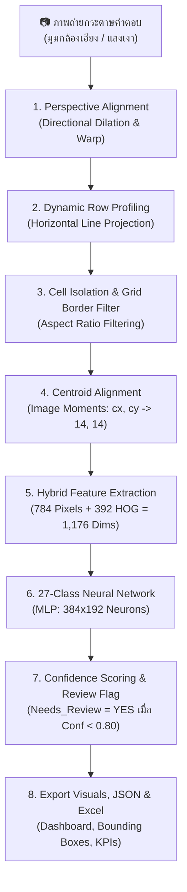

# 📝 Automated Answer Sheet OCR & Evaluation System
### ระบบตรวจและอ่านกระดาษคำตอบอัจฉริยะด้วย Computer Vision และ Machine Learning (20 แถว × 20 ช่อง)

[](https://www.python.org/)
[](https://opencv.org/)
[](https://scikit-learn.org/)
[]()
[]()

---

## 📌 บทนำ (Introduction)

**Project_CV** เป็นระบบประมวลผลภาพ (Computer Vision) และโครงข่ายประสาทเทียม (Deep Learning / MLP) สำหรับตรวจจับ แปลงระนาบ และอ่านตัวอักษรภาษาอังกฤษเขียนมือ (**Handwritten English A–Z**) รวมถึงตรวจจับช่องว่าง (**Empty Space `-`**) จากภาพถ่ายกระดาษคำตอบขนาด **20 แถว × 20 คอลัมน์ (400 ช่องต่อแผ่น)** ได้อย่างรวดเร็วและแม่นยำสูง

ระบบได้รับการออกแบบให้รองรับภาพถ่ายจากกล้องสมาร์ตโฟนทั่วไปที่มีมุมกล้องเอียง แสงเงาไม่สม่ำเสมอ และความผิดเพี้ยนของเลนส์ พร้อมระบบสร้างรายงานผลลัพธ์ในรูปแบบ **Executive Excel Dashboard** และภาพหลักฐานตีกรอบสีเขียว/แดง (Visual Bounding Boxes) อัตโนมัติ

---

## ✨ คุณสมบัติเด่น (Key Features)

* **Robust Perspective Alignment:** ตรวจจับกรอบตาราง 20×20 และดึงภาพให้ตรงด้วย *Directional Vertical Dilation* ขจัดปัญหาตารางเบี้ยวจากการเชื่อมติดแถบมาร์กเกอร์สีดำ
* **Dynamic Row Profiling:** คำนวณพิกัดความสูงของแถวข้อสอบทั้ง 20 แถวด้วย *Horizontal Projection Profile* แม่นยำทุกข้อโดยไม่มีปัญหาแถวเลื่อนสะสม
* **Smart Grid Border Filter:** ตัวกรอง Aspect Ratio อัจฉริยะ ป้องกันเศษเส้นตารางแนวตั้ง/แนวนอนจากการถูกอ่านผิดเป็นตัวอักษร U, L, A
* **Centroid Alignment (Image Moments):** จัดกึ่งกลางมวลหมึกลายมือ $(cx, cy) \rightarrow (14, 14)$ ตามมาตรฐาน MNIST/EMNIST
* **1,176-Dimensional Hybrid Features:** ผสาน Raw Pixels (784 มิติ) เข้ากับ Vectorized HOG Gradients (392 มิติ) ช่วยจำแนกคู่แฝดสับสน เช่น D vs O, I vs J, E vs F ได้อย่างเด็ดขาด
* **27-Class Neural Network Classifier:** โครงข่ายประสาทเทียม MLP (384×192 Neurons) เรียนรู้ทั้ง 26 ตัวอักษรและช่องว่าง
* **Safety Review Tagging:** กลไกตรวจจับความเสี่ยง ติดแท็ก `Needs_Review = YES` อัตโนมัติเมื่อค่าความเชื่อมั่นต่ำกว่า $80\%$ เพื่อให้มนุษย์เข้ามาตรวจสอบเฉพาะจุด
* **Executive Excel Dashboard:** ออกรายงานสรุปไฟล์ Excel สวยงาม ประกอบด้วย KPI Cards, สรุปเปรียบเทียบรายแผ่น, และผลตรวจรายช่องฟอนต์ Consolas

---

## 🏗️ สถาปัตยกรรมระบบ (System Architecture)



---

## 🚀 ประสิทธิภาพการประเมินผล (Benchmark Results)

ผลการประเมินบนชุดข้อมูลภาพถ่ายกระดาษคำตอบลายมือจริง (**Unseen Test Sheet: 400 ช่อง**):

| ตัวชี้วัด (Metric) | ผลลัพธ์ที่ได้ | รายละเอียด |
| :--- | :---: | :--- |
| **ความแม่นยำรวม (Overall Accuracy)** | **94.00%** | **ทายถูกต้อง 376 ตัว จาก 400 ช่อง** |
| **ข้อที่ถูกต้อง 100% ครบทุกช่อง** | **7 ข้อ (35%)** | ถูกต้องสมบูรณ์ทั้ง 20 ช่องรวด |
| **ข้อที่อยู่ในเกณฑ์ยอดเยี่ยม (95% – 100%)** | **13 ข้อ (65%)** | ผิดไม่เกิน 1 ตัวอักษรต่อแถว |
| **ค่าความเชื่อมั่นเฉลี่ยรวม (Avg Confidence)** | **98.9% (0.989)** | มีความมั่นใจในการจำแนกสูงมาก |
| **ความเร็วในการประมวลผล (Speed)** | **~1.6 วินาที / แผ่น** | รันบน CPU ทั่วไปโดยไม่ต้องใช้ GPU |

---

## 📦 โครงสร้างโปรเจกต์ (Project Directory Structure)

```text
Project_CV/
│
├── scan_and_predict.py       # Core Pipeline: Warp, Bounding Boxes, HOG, Centroid, Predict
├── batch_processor.py        # ประมวลผลภาพแบบกลุ่ม & ส่งออก Excel แดชบอร์ด (all_results.xlsx)
├── train_model.py            # สคริปต์ฝึกสอนโครงข่ายประสาทเทียมพร้อม Advanced Augmentation
├── eval_accuracy.py          # เครื่องมือตรวจสอบความแม่นยำและวิเคราะห์ข้อผิดพลาดรายช่อง
├── howtodo.md                # เอกสารสถาปัตยกรรมและเทคนิคการพัฒนาระบบฉบับเต็ม
├── templete_test.md          # เทมเพลตและคู่มือข้อความสำหรับการเขียนทดสอบ 20 แถว x 20 ช่อง
├── requirements.txt          # รายการไลบรารีและแพ็กเกจ Python
├── README.md                 # เอกสารแนะนำและคู่มือการใช้งานโปรเจกต์
│
├── input_images/             # รูปภาพกระดาษคำตอบสำหรับฝึกสอน (1.jpg ถึง 17.jpg)
├── test_image/               # รูปภาพกระดาษคำตอบสำหรับทดสอบ (test1.jpg ฯลฯ)
├── models/
│   └── char_classifier.pkl  # โมเดล MLP น้ำหนักโครงข่ายประสาทเทียม
└── outputs/
    ├── visuals/              # ภาพผลลัพธ์ตีกรอบ Bounding Box (*_result.jpg)
    └── results/              # ไฟล์รายงาน Excel (all_results.xlsx) และ JSON (*_results.json)
```

---

## 🛠️ การติดตั้งและการเริ่มใช้งาน (Installation & Quick Start)

### 1. โคลนโปรเจกต์และสร้าง Virtual Environment
```bash
# Clone repository
git clone https://github.com/your-username/Project_CV.git
cd Project_CV

# สร้าง Virtual Environment และเปิดใช้งาน
python -m venv venv
# สำหรับ Windows:
venv\Scripts\activate
# สำหรับ macOS/Linux:
source venv/bin/activate
```

### 2. ติดตั้งไลบรารีที่จำเป็น
```bash
pip install -r requirements.txt
```

---

## 💻 คู่มือคำสั่งการรันระบบ (Usage Guide)

### 1. ฝึกสอนโมเดล (Train Model)
หากมีการเพิ่มหรือแก้ไขภาพใน `input_images/`:
```bash
python train_model.py
```
*ระบบจะสกัดฟีเจอร์ 1,176 มิติ ทำ Advanced Augmentation (หมุน, เลื่อน, ปากกาหนา/บาง, ซูม) และแสดงความคืบหน้ารอบเทรนแบบ Real-Time ด้วย `tqdm`*

### 2. สแกนและตรวจกระดาษคำตอบ (Batch Processing)
นำภาพถ่ายที่ต้องการตรวจไปวางในโฟลเดอร์ `test_image/` แล้วรัน:
```bash
python batch_processor.py
```
*ระบบจะประมวลผลทุกภาพ สรุปผลลง [outputs/results/all_results.xlsx](file:///d:/Project_CV/outputs/results/all_results.xlsx) และบันทึกภาพตีกรอบลงใน [outputs/visuals/](file:///d:/Project_CV/outputs/visuals/)*

### 3. ประเมินความแม่นยำเทียบกับเฉลย (Evaluate Accuracy)
ตรวจสอบความแม่นยำและแสดงรายการตัวอักษรที่อ่านผิดแบบเจาะลึก:
```bash
python eval_accuracy.py
```

---

## 📄 รูปแบบผลลัพธ์ที่ได้รับ (Outputs Showcase)

1. **Excel Dashboard ([all_results.xlsx](file:///d:/Project_CV/outputs/results/all_results.xlsx)):**
   - **Sheet 1 (`Dashboard_ภาพรวม`):** การ์ด KPI แสดงจำนวนแผ่น, จำนวนข้อ, เปอร์เซ็นต์ความแม่นยำรวม, และตารางสรุปเปรียบเทียบรายแผ่น
   - **Sheet 2 (`Detailed_Results`):** ข้อความคำตอบ 20 ช่องในรูปแบบฟอนต์ Consolas, ค่า Average Confidence, Min Confidence, และแท็กสถานะ `Needs_Review` (เขียว/แดง)
2. **Visual Overlay Images ([outputs/visuals/*_result.jpg](file:///d:/Project_CV/outputs/visuals/)):**
   - กล่องสีเขียว: ตัวอักษรที่ตรวจพบ พร้อมตัวอักษรเฉลยสีแดง
   - กล่องสีเทา: ช่องว่างที่ไม่มีหมึกเขียน
3. **Structured JSON Data ([outputs/results/*_results.json](file:///d:/Project_CV/outputs/results/)):**
   - ข้อมูล Array จัดเก็บคอลัมน์, ตัวอักษรที่ทายได้, และค่า Confidence Score รายช่อง

---

## 👥 ผู้พัฒนาและการมีส่วนร่วม (Author & Contributions)

* **ทีมพัฒนา:** Project_CV Engineering Team
* **เทคโนโลยี:** OpenCV, Scikit-Learn, NumPy, OpenPyXL, Pandas, Tqdm
* หากมีข้อสงสัยหรือต้องการต่อยอดระบบ สามารถเปิด Issue หรือส่ง Pull Request ได้ทันทีครับ
